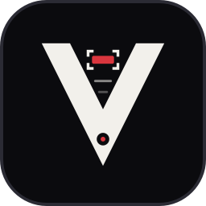

# Real-Time License Plate Recognition



Visus detects, tracks and reads Israeli license plates in real time, from a camera or a video
file, and shows the result in a desktop application. *Visus* is Latin for eyesight.

A fine-tuned YOLO26 detector finds the plates and ByteTrack follows each one across frames.
A CNN+CTC network then reads the whole number in a single pass, without segmenting it into
digits, and the number is confirmed by voting over several frames.
Israeli civilian plates carry digits only (7 or 8), so the reader's decoding is constrained to
exactly those two formats.


<sub>A synthetic scene: the vehicles are AI-generated and every plate number is fictional.</sub>

> **No real license plates.** Every plate number in this repository — in the code, tests,
> documentation, examples and the screenshot — is fictional and does not belong to a real
> vehicle. The repository contains no real images, video or plate data, and no trained models;
> its only image of a street is the synthetic scene above.

## How it works

```text
camera / video
  -> YOLO26m detector        find plate boxes (NMS-free head), 640 px input
  -> ByteTrack               a stable id per plate across frames
  -> crop                    every plate at least 90 px wide, every 4th frame until locked
  -> CNN+CTC reader          whole crop -> 7- or 8-digit number + per-digit confidence;
                             all plates of a frame in one batch
  -> temporal voting         lock the number once enough confident reads agree
  -> plate origin            country from the plate color (yellow -> Israel)
```

**The reader.** The reader converts the crop to gray and resizes it to 48×192. A 2D CNN collapses the
height while keeping 48 columns along the plate. A residual stack of dilated 1D convolutions then
gives every column a view of the whole plate. The network has 1.85 M parameters. It is trained with
CTC loss, which needs only the number string as a label: the network learns by itself where each
digit is. The network is pretrained on synthetic plates and fine-tuned on real crops. Keras 3 runs
on the PyTorch backend, so TensorFlow is not needed.

## Training data

The real data comes from **8 hours of driving footage**: eleven drives through Israeli cities, by
day, at night and in the rain. Ten drives (7.4 hours) are used for training and
validation. The eleventh, a 37-minute drive through Ashdod, a city that appears in no training
video, is held out as the test set and never trained on.

Every video is processed semi-automatically. The detector, tracker and reader run over it, a
plate is kept for the reader only when its number was voted across many frames, and every kept
number is then reviewed, with any doubtful crop dropped.

| | Train | Validation | Test |
|---|---|---|---|
| Detector: video frames | 3,645 | 613 | 341 (held-out drive) |
| Detector: labeled stills | 374 | 46 | 44 |
| Detector: plate boxes | 8,599 | 1,427 | 818 |
| Reader: real plate crops | 5,070 crops of 2,698 plates (5-fold, by plate) | | 424 crops of 217 plates (held-out drive) |
| Reader: synthetic plates (pretraining) | 34,606 | 2,000 | |

Detector frames are split by 10-second blocks of each video, so validation never sees the
training cars. Boxes too small or too uncertain to label are painted over rather than left
unlabeled.

## Evaluation

- **Detector.** `train_detector.py` scores the best checkpoint once on a held-out test split. That
  split is never used for early stopping or checkpoint selection.
- **Reader.** It is scored on whole plates: a plate counts only if every digit is right.
  `train_reader.py --cv` runs 5-fold cross-validation by plate, so every plate is tested by a
  model that never saw it.

Results of the current models on the held-out Ashdod drive (341 frames, 754 plates) and in
cross-validation:

| Model | Test | Result |
|---|---|---|
| Detector | held-out drive | precision 98.5 %, recall 94.2 %, mAP50 0.985 |
| Reader | held-out drive, 424 crops of 217 plates | 98.1 % of whole plates exact (416 of 424) |
| Reader | 5-fold cross-validation by plate, 5,070 crops | 97.5 % of whole plates exact |

## Repository layout

```text
src/                     the system
  app.py                 desktop application (PySide6): source / detector / reader pickers,
                         live video with overlays, per-stage timings, plate panel, passages log
  pipeline.py            real-time engine (worker thread): capture, detect + track, batched
                         reading, voting, timings, gate log
  plate_reader.py        CNN+CTC reader: preprocessing, network, constrained decoding, voting
  plate_origin.py        plate country (from color) and number formatting
  theme.py               colors, fonts, stylesheet, app icon
  common.py              shared helpers: paths, dataset YAML, CUDA, run folders
  predict.py             detector only, on images / video / camera -> annotated output + CSV
  train_detector.py      fine-tune YOLO26m, then score the held-out test split
  train_reader.py        pretrain on synthetic plates, fine-tune on real crops; --cv, --promote
tools/                   data preparation (not part of the live system)
  dataset_check.py       validate YOLO labels and check splits for leakage
  split_dataset.py       deterministic train/val/test split from an immutable pool
  auto_label.py          detector-assisted pre-labels for human review
  extract_frames_from_video.py, downsample_fps.py   video helpers
  synth_plates.py        synthetic Israeli plate crops with exact labels
  gen_scenes.py          plan balanced batches of synthetic vehicle scenes
  number_scenes.py       print realistic numbers onto the blank plates of those scenes
  visualize_yolo_augmentations.py, build_branding.py
tests/                   pytest suite
configs/dataset.yaml     dataset paths and class name for Ultralytics
docs/DATASETS.md         building the datasets from scratch
docs/RUNBOOK.md          every command, from install to training to evaluation
```

Data and trained models are not part of this repository. The code expects them in `data/` and
`weights/` next to `src/`, and `.gitignore` keeps those folders out of git.

## Getting started

Requirements: Python 3.12. A CUDA GPU is recommended for training and for real-time use.
Everything also runs on the CPU, more slowly.

The commands call the Python inside the virtual environment directly, so no activation step is needed.
Windows, cmd or PowerShell:

```bat
python -m venv .venv
.venv\Scripts\python -m pip install -r requirements.txt
```

In Git Bash, write the same path with forward slashes, `.venv/Scripts/python`. On Linux or macOS it is
`.venv/bin/python` (create the environment with `python3 -m venv .venv`). Every command below is written for
cmd and PowerShell.

`requirements.txt` pins the direct dependencies, with the CUDA 12.1 PyTorch build. On a machine
without a GPU, remove the `+cu121` suffixes and the extra index line.
`requirements-exact-versions.txt` is the full `pip freeze` of the verified environment.

**Models.** Trained weights are not published yet; they will be added once trained on a larger
dataset. Until then, the models can be trained from the steps below:
1. Build the datasets ([docs/DATASETS.md](docs/DATASETS.md)).
2. Train both models ([docs/RUNBOOK.md](docs/RUNBOOK.md)).

The app loads `weights/detector/best.pt` and `weights/reader/plate_reader.keras`.

**Run the app:**

```bat
.venv\Scripts\python src/app.py
```

Pick a **Source** (a camera, or *Video file…*), a **Detector** and a **Reader** (the promoted
models, every training run, or any file), and the number of agreeing **Votes** needed to lock a
plate, then press **Start**.

**Plates in view.** Every plate in view gets its own card in the side panel. A card shows:
- the plate as the camera saw it, next to the number read;
- each digit's confidence, with unsure digits marked;
- the country and the scores.

Cards keep their place while their plate is in view. As many cards are shown as the window
height holds, up to four, and a locked plate is marked with the accent edge.

Locked plates are also listed in *Recent passages* and appended to `reports/gate_log.jsonl`:

```json
{"date":"21/10/2026","time":"17:24:43","plate":"12345601","origin":"IL","detector_confidence":0.78,"ocr_digit_mean":0.9996,"ocr_plate_confidence":0.9972}
```

`ocr_plate_confidence` is the product of the per-digit confidences, so one weak digit lowers the
score of the whole number.

## Tests and code quality

```bat
.venv\Scripts\python -m pip install -r requirements-dev.txt
.venv\Scripts\python -m pytest
.venv\Scripts\python -m pytest -m slow
.venv\Scripts\python -m ruff check src tools tests
.venv\Scripts\python -m pyright src tools tests
```

The first `pytest` line is the fast suite; `-m slow` runs end to end on a local clip (see docs/RUNBOOK.md).

Settings for all three tools are in `pyproject.toml`. Tests that need models or data skip
themselves when those are absent.

## Design decisions

- **Read the whole plate with CTC.** No digit segmentation is needed. Segmenting a plate into
  digits is fragile under blur, tilt and dirt.
- **Synthetic pretraining, real fine-tuning.**
  - Real labeled plates are scarce.
  - Rendered plates follow the real Israeli layouts and numbering rules, and their labels are exact
    by construction.
- **Synthetic scenes for the detector (optional).**
  - Image-generation models draw realistic vehicles with **blank** plates, since they cannot be
    trusted to print exact digits.
  - Realistic numbers are then printed onto those plates in the right perspective and light.
  - They can be added to the training set only; validation and test data stay real.
- **Train the detector at its pretraining and inference size (640).** One size from pretraining
  to deployment.
- **No rotation or shear augmentation for the detector.**
  - Ultralytics replaces a rotated box with the box around it. For a long, thin plate, that box is
    much taller than the plate itself, and training on it teaches loose boxes.
  - The reader has its own plate-level augmentation instead: rotation up to ±12° without cutting
    digits, viewing angle, blur, low resolution, compression, lighting, glare and shadow.
- **Cross-validation by plate, plus a held-out drive** for the reader. Cross-validation uses every
  real plate for testing once, and a whole drive from an unseen city is kept aside as the final test.
- **ByteTrack boxes are used as they are.** They are already Kalman-filtered; an extra smoothing
  step adds lag.

## Known limitations

- **Two-row plates** (motorcycles) are detected but not read: the reader reads a single row.
- **A vehicle that is hidden and re-appears** gets a new track id, so it is logged twice.
- **The read gate is in pixels** (90 px wide). It was tuned on 1080p video, so a lower-resolution
  camera needs the plate to fill more of the frame.

## License

[MIT](LICENSE)
